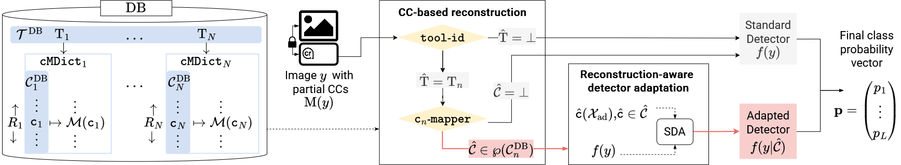
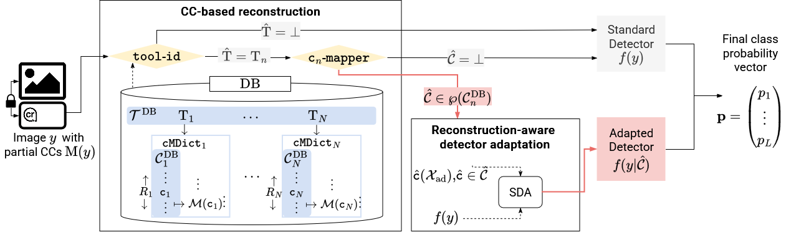

# Enhanced image forensics through partial C2PA-based provenance information

<div align="center">

<!-- badges -->
<!-- [](link2paper) -->

[](https://www.python.org/)
[](https://pytorch.org/)
<!-- end badges -->

</div>

This the official implementation of our paper:

> **Enhanced image forensics through partial C2PA-based provenance information**  
> *Riccardo Ziglio, Eleonora Marchesini, Andrea Montibeller, Giulia Boato, Silvio Ranise, Cecilia Pasquini*  
> Accepted to IEEE Workshop on Information Forensics and Security 2026

Available on [arXiv](link2paper)

---

## Hybrid authenticity verification pipeline

This repository implements the two-step detection strategy presented in the paper:

- **CC-based reconstruction**: Partial CCs of the image under investigation are used for reconstructing the applied command of a certain tool based on an available manifest database (DB) of tools and commands

- **Reconstruction-aware detector adaptation**: Forensic detectors are optimized accordingly through supervised adaptation techniques  (SDA)

<!--  -->



Full resolution pipeline available in [./assets/](./assets/)

---

## Folder Organization

```bash
├── asset/                                     # Diagrams, figures, and media assets (e.g., pipeline architecture scheme)
├── CC-based reconstruction/                   # Core provenance reconstruction pipeline
│   ├── c2pa-preset analysis                   # Tools for parsing, extracting, and analyzing raw C2PA edit actions
│   └── cn-mapper                              # Matching engine that attributes extracted actions to known preset databases
├── paper-plots/                               # Scripts and data used to generate figures and performance evaluation plots for the paper
├── Reconstruction-aware detector adaptation   # Forensic models adapted using the reconstructed post-processing metadata
└── README.md                                  # Primary repository overview, setup guide, and documentation 
```

*Note: More implementation details are contained in the README.md file within each component's subfolder.*

---

## Models and Dataset Downloads

- **Pre-trained Checkpoints**: Download from [SharePoint Release Link](https://fbk-my.sharepoint.com/my?id=%2Fpersonal%2Frziglio%5Ffbk%5Feu%2FDocuments%2FSharedMaterial%2FReplicationPackages%2FWIFS2026%5FReplicationPackage%2FWIFS2026%5FFTmodels&ga=1&share=cgqiQOCr3hxKSIPfO6eEDcXTEgUCI%2D10cYG3HBP9NMapILfHOw)

- **Dataset**: Download the experimental dataset from [SharePoint Data Link](https://fbk-my.sharepoint.com/my?id=%252Fpersonal%252Frziglio_fbk_eu%252FDocuments%252FSharedMaterial%252FReplicationPackages%252FWIFS2026_ReplicationPackage%252FWIFS2026_C2PAdataset&ga=1)

---

## Requirements

### Python

Python 3.10 or later.

### c2patool

The analyzer relies on `c2patool` to read C2PA manifests from images. Install it before running the project.

**Option A — via Cargo (Rust):**

```bash
cargo install c2patool
```

Then make sure `~/.cargo/bin` is in your `PATH`:

```bash
export PATH="$HOME/.cargo/bin:$PATH"
```

Add that line to your `~/.bashrc` or `~/.zshrc` to make it permanent.

**Option B — pre-built binary:**
Download the latest release for your platform from:
<https://github.com/contentauth/c2patool/releases>

---

## Citation

TODO: add citation

<!-- If your research uses our dataset, models and code, partially or in full, please cite:

```bash
@INPROCEEDINGS{11113429,
  author={Ziglio, Riccardo and Pasquini, Cecilia and Ranise, Silvio},
  booktitle={2025 13th International Workshop on Biometrics and Forensics (IWBF)}, 
  title={Spotting Tell-Tale Visual Artifacts in Face Swapping Videos: Strengths and Pitfalls of CNN Detectors}, 
  year={2025},
  volume={},
  number={},
  pages={01-06},
  keywords={Biometrics;Visualization;Forensics;Soft sensors;Conferences;Detectors;Real-time systems;Data models;Faces;Videos;face swapping;face verification;remote video calls;forensic detection},
  doi={10.1109/IWBF63717.2025.11113429}
}
``` -->

<!-- add licence? -->
